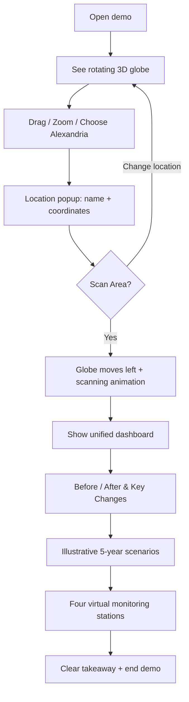

# 02 — Sitemap, User Flow & User Journey

## Mini sitemap (only what is needed tomorrow)

```text
Earth Sentinel Demo
├── Welcome overlay (optional)
└── Main Dashboard (one route /)
    ├── 3D Earth Explorer
    ├── Location Popup
    ├── Scanning State
    ├── Human Intelligence Summary
    ├── Before vs After
    ├── Key Changes + Trend Verdict
    ├── 5-Year Scenario
    └── Four Virtual Monitoring Stations
```

**Navigation:** Dashboard, Analysis, Forecast, Discovery can simply scroll to or activate dashboard sections. Projects, Reports, Pricing, Settings and Administration are **not implemented**.

## The one primary user flow



## User journey in 6 moments
| Moment | User action | UI reaction | What audience understands |
|---|---|---|---|
| 1. Curiosity | Opens app | Earth slowly rotates | A planet-scale experience |
| 2. Control | Rotates / zooms | Globe responds naturally | They can explore anywhere |
| 3. Selection | Clicks Alexandria | Target locks; popup appears | The system understands place / coordinates |
| 4. Investigation | Clicks Scan | Scanner and stations animate | Data-driven investigation workflow |
| 5. Insight | Reads dashboard | Comparison, changes, scenario | Why the location changed |
| 6. Decision | Reviews finding | Clear next-step suggestion | The platform helps frame questions |

## Popup specification
**Title:** Alexandria, Egypt  
**Metadata:** 31.20° N · 29.92° E  
**Subtext:** “Selected area: demo region” or selectable radius  
**Primary CTA:** `Scan Area`  
**Secondary CTA:** `Change Location`  
**Badge:** `Demo Data`

### Interactions
- Close or change location returns to globe selection.
- Click Scan triggers a short state sequence: `preparing → scanning → summarizing → complete`.
- When complete, reveal the dashboard (without a new page load).
- If user changes location, update all demo cards from the same location dataset, or label them unavailable; **never keep Alexandria’s data for another named region**.

## Key UX requirement
The audience must see a satisfying **one-click-to-insight** journey without reading instructions. Keep the demo path discoverable with a prominent glow on the selected target and `Scan Area` button.
